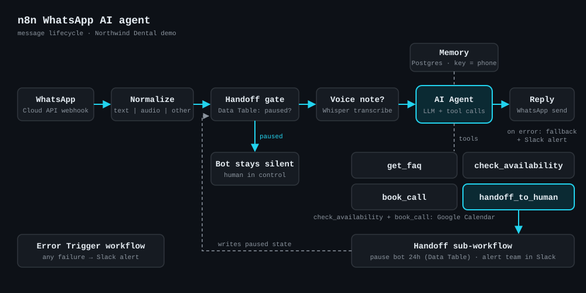

# n8n WhatsApp AI Agent

An importable n8n template for a production-minded WhatsApp assistant. It answers on the WhatsApp Business Cloud API, remembers each contact's conversation, understands voice notes, qualifies the lead with an LLM that calls tools, books a consultation in Google Calendar, and hands the conversation to a human through Slack, pausing itself so the bot and the human never talk over each other. The example business is **Northwind Dental**, a fictional dental clinic; swap the prompt and FAQ to fit yours.



## Features

- **WhatsApp Cloud API in and out** with the native n8n WhatsApp nodes. Replies go out from the same business number that received the message.
- **Per-contact memory** in Postgres, keyed by the sender's phone number, so context survives restarts and queue mode.
- **Voice notes**: audio is downloaded with the WhatsApp credential and transcribed with OpenAI Whisper, then treated like typed text.
- **Tool-calling agent** (`@n8n/n8n-nodes-langchain.agent`) with four tools:
  - `get_faq`: static, editable knowledge base (no hallucinated facts).
  - `check_availability`: Google Calendar free/busy check.
  - `book_call`: creates the calendar event, only after the slot is confirmed.
  - `handoff_to_human`: sub-workflow that pauses the bot and alerts Slack.
- **Guardrailed system prompt**: stays in scope, never invents prices or availability, asks one question at a time, explicit escalation rules.
- **Failure handling**: retries on WhatsApp calls, a safe fallback reply plus Slack alert if the agent fails, and an Error Trigger workflow for everything else.

## Repository layout

```
workflows/
  whatsapp-ai-agent.json   main workflow (trigger -> agent -> reply)
  handoff-to-human.json    sub-workflow used by the handoff_to_human tool
  error-handler.json       Error Trigger -> Slack alert
prompts/
  system-prompt.md         the agent's system prompt (also embedded in the AI Agent node)
docs/
  architecture.svg         diagram above
```

## How it works

Lifecycle of one inbound message:

1. **WhatsApp Trigger** receives the webhook from Meta.
2. **Normalize Message** (Code) flattens the payload into `{ phone, name, kind, text, mediaId, phoneNumberId }`. Delivery and read receipts carry no message and are dropped here. Button replies become text; images, stickers and other types become a short note the agent can respond to.
3. **Get Contact State** reads the contact's row from the `whatsapp_contact_state` Data Table. **Resolve Bot State** decides whether the bot is paused (`paused = true` and `paused_until` still in the future).
4. **Bot Paused?** If a human has taken over, the execution ends silently.
5. **Is Voice Note?** Audio goes through **Get Media URL**, **Download Voice Note** (authenticated HTTP) and **Transcribe Voice Note** (Whisper). Both paths converge on the same `{ phone, name, text, source }` shape.
6. **AI Agent** runs with the system prompt, the last 20 messages for this phone number, and the four tools. It qualifies the lead one question at a time and books or hands off as needed.
7. **Send WhatsApp Reply** sends the agent's answer. If the agent errors, **Send Fallback Reply** apologises to the contact and **Alert Team** posts to Slack.

## Setup

Requirements: a recent n8n release that includes Data Tables and the AI Agent node v3.1 (the template was built against the current node catalog), a Postgres database reachable from n8n, a Meta developer app with WhatsApp, an OpenAI API key, a Google Calendar, and a Slack workspace.

### 1. Credentials to create in n8n

Names below match the placeholders in the JSON, so n8n will pick them up or let you select them after import.

| Credential name | n8n type | Used by |
| --- | --- | --- |
| `WhatsApp Trigger account` | WhatsApp OAuth API (App ID + App Secret) | WhatsApp Trigger |
| `WhatsApp account` | WhatsApp API (permanent access token + Business Account ID) | Get Media URL, Download Voice Note, replies |
| `OpenAI account` | OpenAI | Chat model, Whisper transcription |
| `Postgres account` | Postgres | Conversation memory |
| `Google Calendar account` | Google Calendar OAuth2 | check_availability, book_call |
| `Slack account` | Slack API (bot token with `chat:write`) | Handoff alerts, error alerts |

Use a **System User permanent token** for WhatsApp in production; temporary tokens from the Meta dashboard expire after 24 hours.

### 2. Data Table for handoff state

In n8n, create a Data Table named **`whatsapp_contact_state`** with these columns:

| Column | Type | Meaning |
| --- | --- | --- |
| `phone` | string | Sender's number as WhatsApp sends it (country code, no `+`) |
| `paused` | boolean | `true` while a human owns the conversation |
| `paused_until` | date | When the pause expires automatically |
| `reason` | string | Why the handoff happened |

The memory table (`whatsapp_chat_histories`) is created automatically by the Postgres Chat Memory node on first run.

### 3. Import the workflows

1. Import `workflows/error-handler.json` and `workflows/handoff-to-human.json` (Workflows > Import from file).
2. Import `workflows/whatsapp-ai-agent.json`.
3. In the main workflow, open the **handoff_to_human** tool and select the imported *Handoff To Human* workflow (replaces `REPLACE_WITH_HANDOFF_WORKFLOW_ID`).
4. In **check_availability** and **book_call**, pick your calendar (replaces `REPLACE_WITH_CALENDAR_ID`).
5. In the Slack nodes, pick your channels (defaults: `#whatsapp-handoffs` and `#automation-alerts`).
6. In **Settings > Error workflow** of both the main and the handoff workflow, select *Error Handler*.
7. Set the workflow timezone (default `America/New_York`) so the agent's date context and bookings match your clinic.

### 4. Connect the Meta webhook

1. Activate the main workflow. The WhatsApp Trigger registers its webhook with your Meta app using the trigger credential; your n8n instance must be reachable over public HTTPS (`WEBHOOK_URL` set correctly).
2. In the Meta app dashboard, under WhatsApp > Configuration, confirm the webhook is subscribed to the **messages** field.
3. Send a WhatsApp message to your business number and watch the execution in n8n.

A Meta app allows one webhook URL per app. If another tool already uses it, create a separate Meta app for this agent.

### Configuration knobs

| What | Where |
| --- | --- |
| Model | **OpenAI Chat Model** node (`gpt-5-mini` by default) |
| Memory depth | **Conversation Memory** > Context Window Length (20) |
| Pause duration | **Pause Bot** node in the handoff workflow (`+ 24 hours`) |
| Persona and rules | `prompts/system-prompt.md`, pasted into **AI Agent** > System Message |
| Clinic facts | `FAQ` array in the **get_faq** tool |

## Handoff design

An AI agent that keeps answering after a person has stepped in is worse than no agent at all. So the handoff is a **state change, not just a notification**:

- When `handoff_to_human` runs, the sub-workflow upserts the contact's row with `paused = true` and `paused_until = now + 24h`, then posts the reason and a conversation summary to Slack.
- Every inbound message passes the **handoff gate** before anything else. While paused, the bot reads nothing, calls no model and sends nothing, so the human owns the thread.
- The pause **expires on its own**, so a forgotten handoff never silences a contact forever.
- **Resuming early**: set `paused = false` (or delete the row) in the `whatsapp_contact_state` Data Table. The next message goes back to the bot, which still has the conversation memory.
- **Taking over manually** (without the bot asking): add or edit the row yourself with `paused = true`. Any internal tool, such as a Slack shortcut or CRM webhook, can do the same with one Data Table upsert.

The agent decides *when* to escalate (prompt rules: asks for a person, emergency, complaint, frustration, repeated out-of-scope requests); the workflow guarantees *what happens* after it does. The tool receives the phone number from the workflow, not from the model, so the model cannot pause the wrong contact.

## Customizing for your business

1. Rewrite `prompts/system-prompt.md`: role, qualification questions, booking rules, escalation rules. Paste it into the AI Agent's System Message (keep the *Runtime context* block at the end).
2. Replace the `FAQ` entries in **get_faq**. For larger knowledge bases, swap the tool for a vector store tool.
3. Change the booking tool: the Google Calendar nodes can be replaced with Cal.com, a CRM, or an HTTP Request tool without touching the rest of the flow.
4. Route handoffs wherever your team works: replace the Slack node in the handoff workflow with email, Teams, or a helpdesk ticket.

## Limitations

- **No human reply console.** The template pauses the bot and alerts your team; the human answers from whatever inbox is connected to the number (for example a shared-inbox or CRM tool on the Cloud API).
- **24-hour window.** WhatsApp only allows free-form replies within 24 hours of the contact's last message. Follow-ups after that need approved templates, which this template does not send.
- **No deduplication.** Meta can redeliver a webhook; a busy instance may occasionally answer the same message twice. Store `messageId` and skip repeats if this matters to you.
- **Bursts of messages** from one contact are answered one by one, not batched.
- **Images and documents** are not analysed; the agent asks the contact to describe them.
- **Not validated in a live instance as shipped.** Node types and versions were checked against the n8n node catalog, but you must attach credentials and run a test conversation before going live.
- The FAQ and clinic are fictional. Nothing here is medical advice.

## License

[MIT](LICENSE) © 2026 Humberto Rivero
